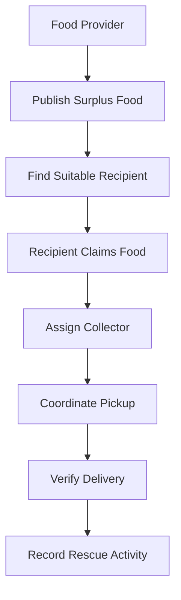
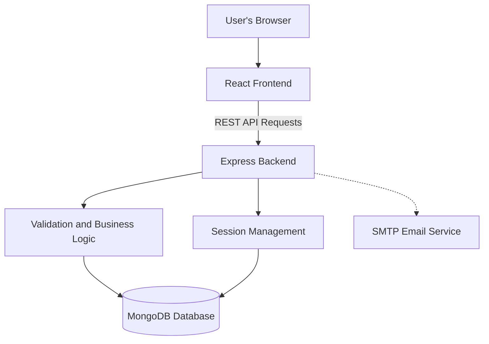

# 🍱 FoodRescue — Turning Surplus Food into Shared Hope

**A food rescue platform designed to connect surplus food providers with recipient organizations and collectors to help reduce food waste and improve food accessibility.**

FoodRescue is a full-stack web application being developed to make surplus food rescue more organized, traceable, and accessible. It aims to connect people and organizations that have surplus food with organizations that can distribute it to people in need.

Instead of allowing safe surplus food to go to waste, FoodRescue aims to support a coordinated process for making it available, arranging collection, and improving accountability.

> **Project status:** Foundation and initial authentication and organization-verification features implemented. The complete food donation and collection workflow is still under development.

---

## 🌍 1. The Problem

Food waste and food insecurity can exist at the same time. Restaurants, caterers, food businesses, and other providers may have surplus food, while community organizations work to provide food to people who need it.

Coordinating these groups can be difficult when information is scattered across phone calls, messages, and informal networks.

Key challenges include:

- **Disconnected participants:** Food providers and recipient organizations may struggle to find and coordinate with one another.
- **Time-sensitive food:** Surplus food needs timely coordination to avoid unnecessary waste.
- **Trust and verification:** Organizations need a way to establish their identity and legitimacy.
- **Collection coordination:** Pickup responsibilities and delivery status need clear tracking.
- **Limited visibility:** Without organized records, measuring rescue activities and their impact becomes difficult.

FoodRescue is designed to address these coordination challenges through a shared digital platform.

## 💡 2. Our Solution

FoodRescue aims to bring food providers, recipient organizations, and collectors together in one system.

The planned workflow is:

1. **Provide:** A food provider makes surplus food available for rescue.
2. **Connect:** The platform helps identify suitable recipient organizations.
3. **Claim:** An eligible organization claims available food.
4. **Collect:** An assigned collector coordinates the pickup.
5. **Verify:** Pickup and delivery can be confirmed through verification mechanisms.
6. **Measure:** Rescue records can support future impact reporting.

These steps describe the intended complete workflow. Donation management, matching, collection assignment, and delivery verification are planned features, not claims of currently implemented functionality.

## 👥 3. Who Is FoodRescue For?

| User role | Purpose |
|---|---|
| Food Provider | Businesses or organizations with surplus food |
| Recipient Organization | Organizations that receive and distribute food |
| Collector | People responsible for coordinating food pickup and delivery |
| Administrator | Authorized person responsible for organization verification and administrative actions |

The current foundation supports registration for food providers, recipient organizations, and collectors. Administrative functionality includes organization approval, rejection, and suspension routes.

## ✨ 4. Key Features

### Currently Implemented

- Responsive web interface with a landing page and authentication screens.
- Role-based registration for supported public user types.
- Email and password authentication.
- Secure password hashing.
- HTTP-only session cookies with MongoDB-backed session storage.
- Login, logout, and current-user API routes.
- Input validation and login rate limiting.
- Email verification and password recovery token workflows.
- Password change functionality.
- Administrative routes for organization verification decisions.
- Audit-event data model for supporting administrative accountability.
- MongoDB health reporting without fake database data or an in-memory fallback.
- Unit tests for password/token utilities and registration validation.

Email delivery requires SMTP configuration. Production security and external integrations still need deployment-specific verification.

### Planned Features

- Create, update, and manage food donations.
- Browse available surplus food.
- Claim full or partial donations.
- Match donations with recipient organizations.
- Assign collectors and coordinate pickups.
- Pickup and delivery confirmation codes.
- Real-time notifications and status updates.
- Maps and live location tracking.
- Food rescue impact dashboards and analytics.
- Incident reporting and remaining role-specific dashboards.

See [`docs/IMPLEMENTATION_STATUS.md`](docs/IMPLEMENTATION_STATUS.md) for the detailed implementation status.

## 🔄 5. How the Platform Will Work



**Note:** This diagram represents the intended end-to-end workflow. Several workflow stages are still planned and are not yet implemented.

## 🏗️ 6. System Architecture

FoodRescue uses a separate frontend and backend, with MongoDB as its persistent data store.



The frontend communicates with the backend through REST API requests. The backend handles authentication, validation, session management, and database operations. SMTP supports email verification and password recovery when configured.

The architecture is designed to support future donation, matching, and collection modules without relying on hardcoded demo records.

## 🛠️ 7. Technology Stack

| Technology | Purpose |
|---|---|
| React | User interface |
| TypeScript | Type-safe application development |
| Vite | Frontend development and build tooling |
| Node.js | Backend runtime |
| Express.js | REST API and request handling |
| MongoDB | Persistent data storage |
| Mongoose | Database models and queries |
| Zod | Environment and input validation |
| Vitest | Unit testing |
| Helmet | HTTP security headers |
| SMTP / Nodemailer | Email verification and password recovery |

## 🔐 8. Security and Data Integrity

Security is an important part of the FoodRescue foundation.

- Passwords are hashed before being stored.
- Sessions use HTTP-only cookies and persistent MongoDB-backed storage.
- Public registration does not permit users to choose the administrator role.
- Authentication and administrative routes have separate responsibilities.
- Login attempts are rate-limited.
- Input validation is used to reject invalid data.
- Verification and reset tokens are designed to be single-use, hashed, and time-limited.
- Database health is reported honestly instead of substituting fake records.
- Production secrets must be provided through environment variables and never committed to the repository.

The final deployment still requires security review, database access controls, HTTPS and cookie verification, monitoring, backup planning, and testing of the complete application.

## 🚀 9. Run the Project Locally

### Prerequisites

- Node.js 20 or later.
- npm 10 or later.
- MongoDB Atlas or a local MongoDB instance.
- SMTP credentials if email delivery needs to be tested.

### Step 1: Clone the repository

```bash
git clone https://github.com/chittepupallavi123/FoodRescue.git
cd FoodRescue
```

### Step 2: Install dependencies

```bash
npm install
```

### Step 3: Configure environment variables

Create `backend/.env` and configure the required values using the project's environment example and `backend/src/config/env.ts`.

Configure at least the appropriate MongoDB connection string, a unique session secret of at least 32 characters, and the correct frontend origin. SMTP settings are required for actual email delivery.

**Never commit `.env` files or credentials to GitHub.**

### Step 4: Start the backend

From the project root:

```bash
npm run dev --workspace backend
```

### Step 5: Start the frontend

Open a second terminal in the project root:

```bash
npm run dev --workspace frontend -- --port 5174 --strictPort
```

Open the application at:

**http://localhost:5174**

### Step 6: Check backend health

Visit:

**http://localhost:4000/api/v1/health**

The health endpoint reports backend/database status. Database-dependent features require a successful database connection.

### Step 7: Run project checks

Type checking:

```bash
npm run typecheck
```

Unit tests:

```bash
npm test
```

Production build:

```bash
npm run build
```

## 🧪 10. Testing and Verification

The foundation includes unit tests for password/token utilities and registration validation.

Type checking, unit tests, production builds, database connectivity, SMTP delivery, and deployed application behavior are separate verification activities.

A successful build does not, by itself, prove that all features work end to end. The complete donation workflow and external integrations must be tested as they are implemented.

## 📈 11. Expected Impact

FoodRescue aims to create value for participating communities by supporting:

- Less avoidable surplus food waste.
- Better coordination between providers and recipient organizations.
- More organized pickup and delivery processes.
- Greater accountability through recorded actions.
- Better visibility into rescued food and completed deliveries.
- A foundation for measuring food rescue activity over time.

Actual impact should be measured using verified donation, collection, and delivery records once those features are implemented. No impact statistics are claimed at this stage.

## 🗺️ 12. Development Roadmap

| Phase | Focus | Status |
|---|---|---|
| Phase 1 | Project planning and requirements | Initial planning completed |
| Phase 2 | Application foundation and database models | Implemented |
| Phase 3 | Authentication and organization verification foundation | Initial implementation completed |
| Phase 4 | Donation creation and management | Planned |
| Phase 5 | Recipient matching and collector coordination | Planned |
| Phase 6 | Pickup/delivery verification and notifications | Planned |
| Phase 7 | Impact reporting, end-to-end testing, and deployment validation | Planned |

The status of individual features may evolve; consult the implementation-status document for the latest details.

## 🌱 13. Future Scope

Future development can extend FoodRescue with:

- Smarter rule-based matching based on food availability and recipient needs.
- Food safety details, expiry information, and collection time windows.
- Live pickup coordination and delivery updates.
- Verified impact reports based on real records.
- Notifications for new donations and collection changes.
- Additional monitoring, accessibility, and operational safeguards.

These are potential future enhancements, not currently available features.

## 🤝 14. Contributing

Contributions and suggestions are welcome.

1. Fork the repository.
2. Create a feature branch.
3. Make focused changes.
4. Run the relevant tests and checks.
5. Submit a pull request describing the change and its verification.

Do not include credentials, private user data, or unverified claims in contributions.

## 📄 15. Project Information

- **Project:** FoodRescue
- **Category:** Full-stack web application / Social impact technology
- **Repository:** [github.com/chittepupallavi123/FoodRescue](https://github.com/chittepupallavi123/FoodRescue)
- **Deployment:** Not yet deployed
- **License:** Not yet specified

## ❤️ Our Vision

**Rescue surplus. Connect communities. Reduce waste.**

FoodRescue aims to make surplus food rescue more coordinated, trustworthy, and measurable by connecting the people and organizations that can help food reach those who need it.

*Built as a phased software project with a focus on practical social impact, secure foundations, and transparent implementation status.*


